# Klondike Solitaire — CSC200 DSA Edition

[](https://github.com/luqmanbuttcs/dsa-project/actions/workflows/tests.yml)


A desktop **Klondike Solitaire** game built with Python and PyQt6 for the CSC200 Data Structures and Algorithms project. It combines a playable Solitaire implementation with a live **DSA Lab** that lets viewers inspect the data structures used by the running game.

The default application is the premium casino-style interface. The game rules and data model are kept separate from the presentation layer: the UI sends player actions to the game controller and engine, while the engine validates and applies the actual game-state changes.

## Screenshots

The repository contains **all 38 project screenshots** below. They are grouped and captioned so viewers can identify the feature, DSA inspector, interaction, or window size shown. Select an image to view its full-resolution version.

### Current application screens

These images show the current Play workspace and the eight DSA Lab pages. Click any image to open the full-size file.

<table>
<tr>
<td width="50%" valign="top">
<strong>01 · Main Play Workspace (1600 × 900)</strong><br>
<sub>The premium Solitaire board, header metrics, live DSA dashboard, Move Log, and feedback panel.</sub><br><br>
<a href="docs/screenshots/ds_01_play_workspace_1600x900.png"></a>
</td>
<td width="50%" valign="top">
<strong>02 · DSA Lab Overview</strong><br>
<sub>Overview of the five required data structures with live game-session information.</sub><br><br>
<a href="docs/screenshots/ds_02_lab_overview.png"></a>
</td>
</tr>
<tr>
<td width="50%" valign="top">
<strong>03 · Array / List Inspector</strong><br>
<sub>Deck lifecycle view: creation, shuffle, deal, and remaining cards.</sub><br><br>
<a href="docs/screenshots/ds_03_lab_array.png">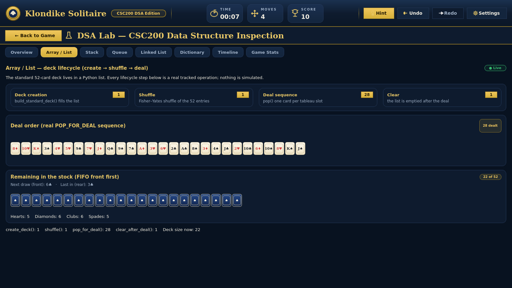</a>
</td>
<td width="50%" valign="top">
<strong>04 · Stack Inspector</strong><br>
<sub>Stack contents, card order, pile composition, and recent stack operations.</sub><br><br>
<a href="docs/screenshots/ds_04_lab_stack.png">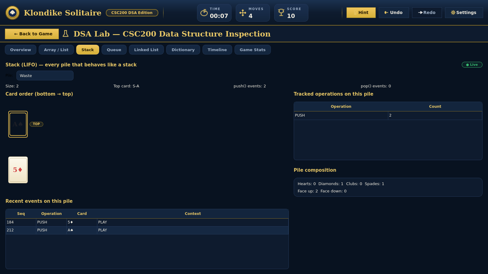</a>
</td>
</tr>
<tr>
<td width="50%" valign="top">
<strong>05 · Queue Inspector</strong><br>
<sub>Stock queue with FIFO order, front/rear positions, and queue operations.</sub><br><br>
<a href="docs/screenshots/ds_05_lab_queue.png">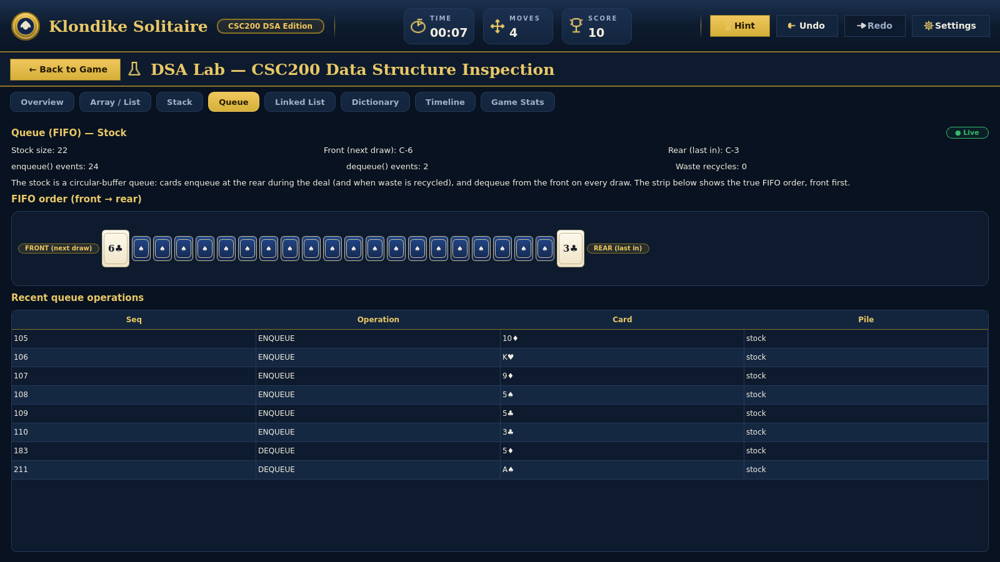</a>
</td>
<td width="50%" valign="top">
<strong>06 · Linked List Inspector</strong><br>
<sub>Tableau linked-list nodes, links, and run operations.</sub><br><br>
<a href="docs/screenshots/ds_06_lab_linked_list.png">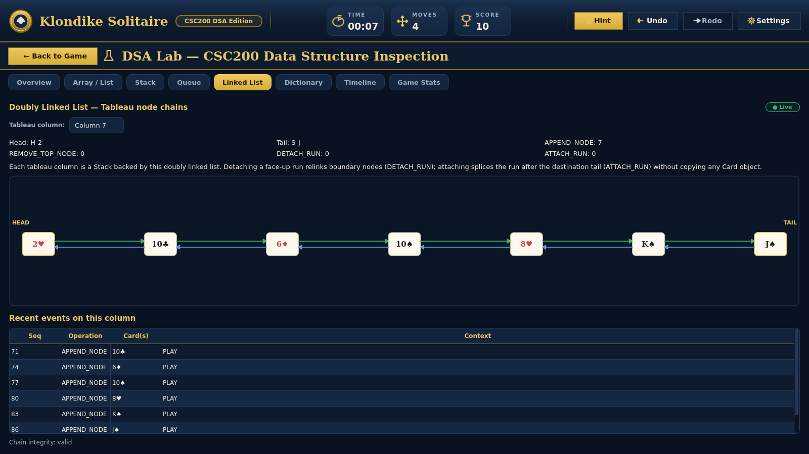</a>
</td>
</tr>
<tr>
<td width="50%" valign="top">
<strong>07 · Dictionary Inspector</strong><br>
<sub>Searchable card index showing each card's current zone, pile, position, and face state.</sub><br><br>
<a href="docs/screenshots/ds_07_lab_dictionary.png">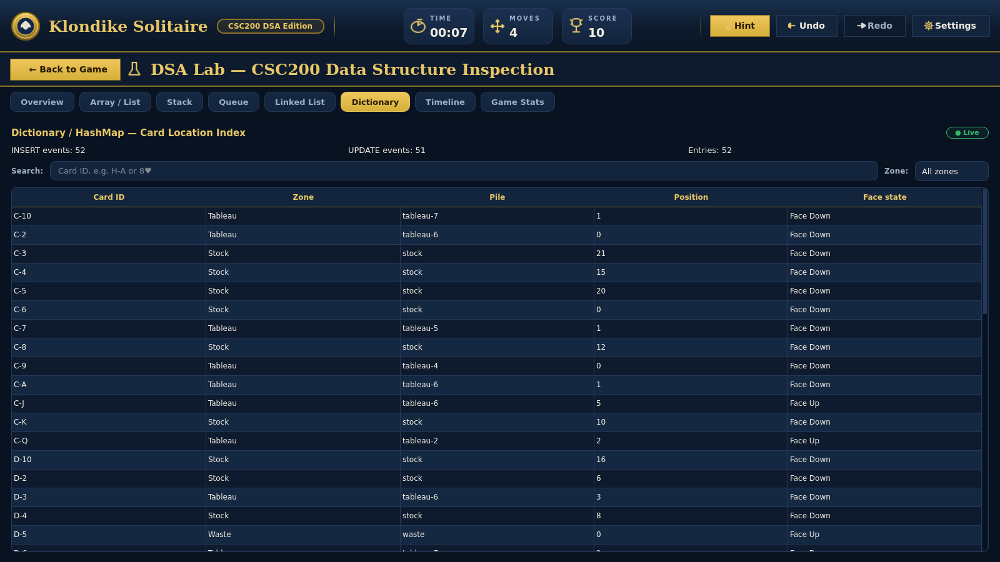</a>
</td>
<td width="50%" valign="top">
<strong>08 · Operation Timeline</strong><br>
<sub>Chronological low-level operations recorded by the live OperationTracker.</sub><br><br>
<a href="docs/screenshots/ds_08_lab_timeline.png">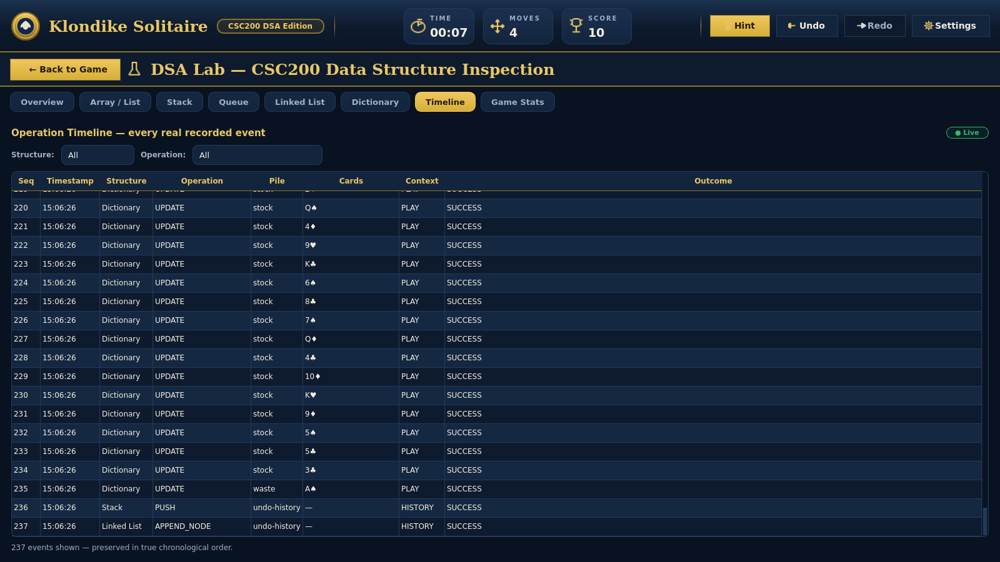</a>
</td>
</tr>
<tr>
<td width="50%" valign="top">
<strong>09 · Game Stats</strong><br>
<sub>Current game statistics and Foundation progress.</sub><br><br>
<a href="docs/screenshots/ds_09_lab_stats.png">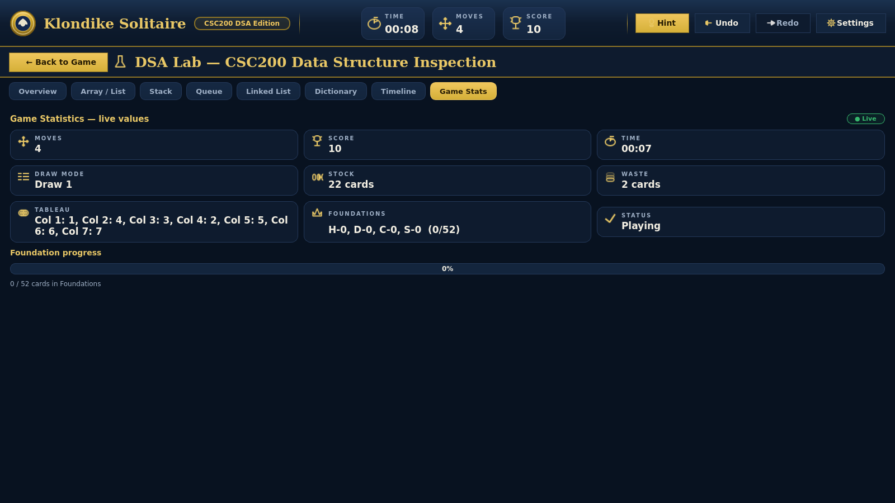</a>
</td>
<td width="50%" valign="top">
<strong>10 · Play Workspace and DSA Lab Comparison</strong><br>
<sub>Side-by-side view of the two main application workspaces.</sub><br><br>
<a href="docs/screenshots/ds_13_play_lab_comparison.png">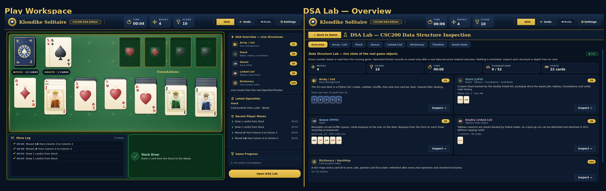</a>
</td>
</tr>
</table>

### Gameplay interactions and visual effects

These screenshots highlight individual game states and interaction feedback, including card selection, dragging, dealing, and victory.

<table>
<tr>
<td width="50%" valign="top">
<strong>11 · Premium Play Workspace</strong><br>
<sub>Full view of the premium casino-style game interface.</sub><br><br>
<a href="docs/screenshots/pr_01_play_workspace.png"></a>
</td>
<td width="50%" valign="top">
<strong>12 · Mid-game Board State</strong><br>
<sub>A populated Tableau and Waste during active play.</sub><br><br>
<a href="docs/screenshots/pr_02_play_midgame.png">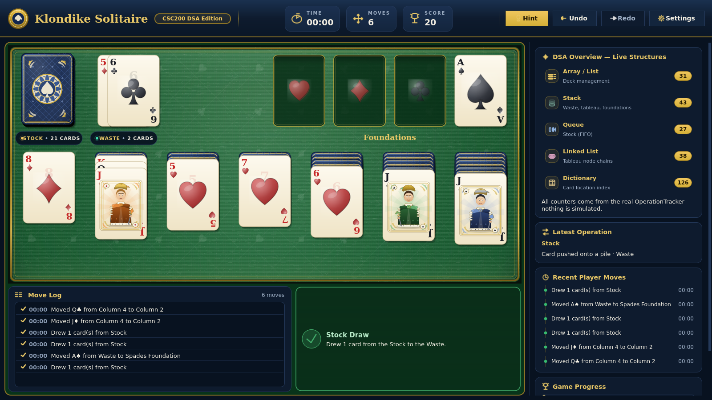</a>
</td>
</tr>
<tr>
<td width="50%" valign="top">
<strong>13 · Header Metric Chips</strong><br>
<sub>Close-up of the Time, Moves, and Score display.</sub><br><br>
<a href="docs/screenshots/pr_03_chips_closeup.png">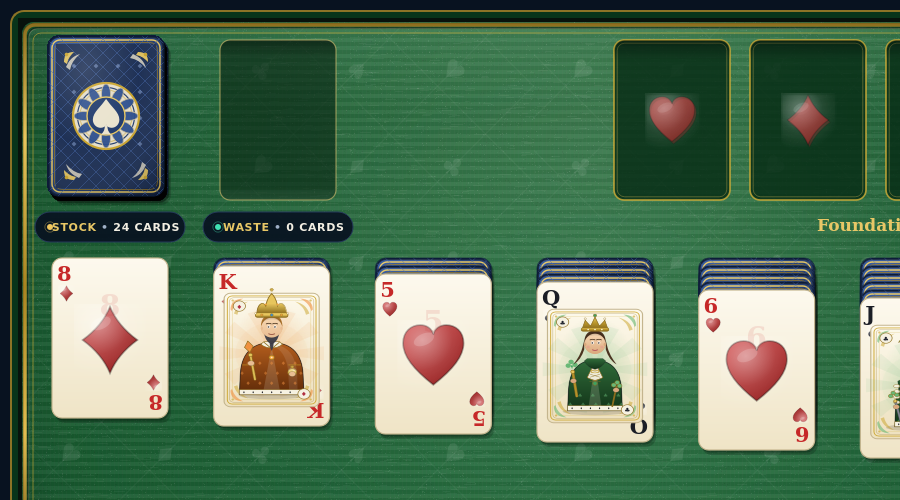</a>
</td>
<td width="50%" valign="top">
<strong>14 · Stock and Waste Area</strong><br>
<sub>Close-up of the Stock and Waste piles and their card presentation.</sub><br><br>
<a href="docs/screenshots/pr_03_stock_waste_chips.png"></a>
</td>
</tr>
<tr>
<td width="50%" valign="top">
<strong>15 · Card Hover / Lift Feedback</strong><br>
<sub>Card lift effect shown during pointer interaction.</sub><br><br>
<a href="docs/screenshots/pr_04_hover_lift.png">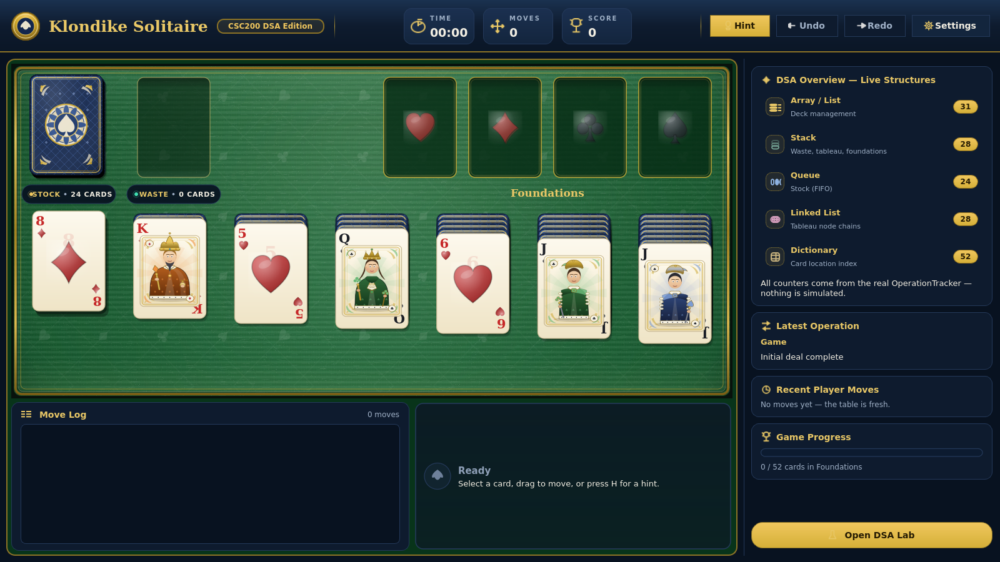</a>
</td>
<td width="50%" valign="top">
<strong>16 · Selected Card Highlight</strong><br>
<sub>Gold selection treatment around the selected card or run.</sub><br><br>
<a href="docs/screenshots/pr_05_selection_gold_ring.png">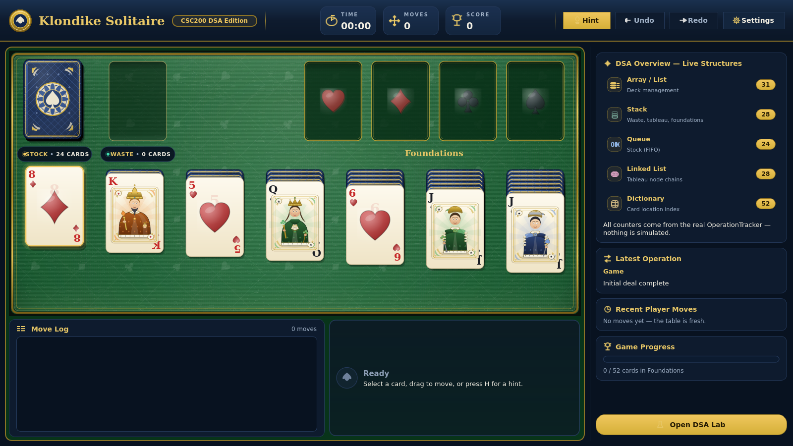</a>
</td>
</tr>
<tr>
<td width="50%" valign="top">
<strong>17 · New-game Deal Animation</strong><br>
<sub>Cards being dealt from the Stock into the Tableau.</sub><br><br>
<a href="docs/screenshots/pr_06_deal_frame.png"></a>
</td>
<td width="50%" valign="top">
<strong>18 · Manual Drag Interaction</strong><br>
<sub>A card or face-up run being dragged across the board.</sub><br><br>
<a href="docs/screenshots/pr_07_manual_drag.png">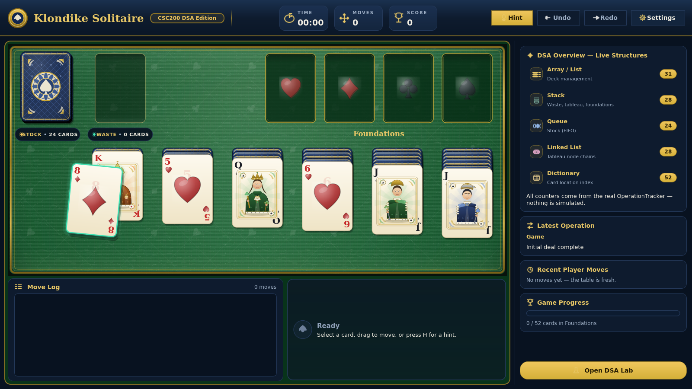</a>
</td>
</tr>
<tr>
<td width="50%" valign="top">
<strong>19 · Foundation Landing Effect</strong><br>
<sub>Particle burst and visual feedback when a card reaches a Foundation.</sub><br><br>
<a href="docs/screenshots/pr_10_foundation_burst.png"></a>
</td>
<td width="50%" valign="top">
<strong>20 · Foundation After Landing</strong><br>
<sub>The board after the Foundation landing animation settles.</sub><br><br>
<a href="docs/screenshots/pr_10b_foundation_settled.png">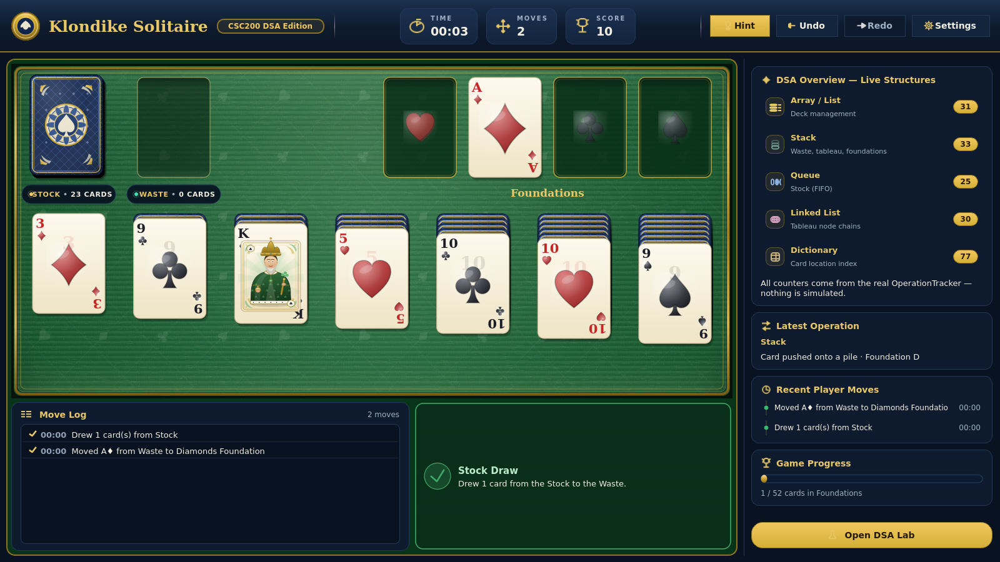</a>
</td>
</tr>
<tr>
<td width="50%" valign="top">
<strong>21 · Victory Overlay</strong><br>
<sub>The non-blocking victory presentation with the completed game's results.</sub><br><br>
<a href="docs/screenshots/pr_13_victory.png">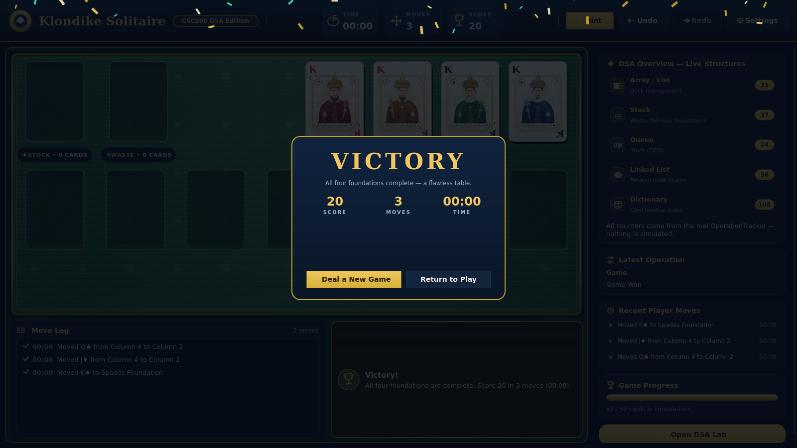</a>
</td>
<td width="50%" valign="top"></td>
</tr>
</table>

### Dashboard and DSA Lab detail views

Additional screenshots documenting the dashboard and selected inspector layouts.

<table>
<tr>
<td width="50%" valign="top">
<strong>22 · Live DSA Dashboard</strong><br>
<sub>Structure counts, latest operation, recent moves, and game progress.</sub><br><br>
<a href="docs/screenshots/pr_11_dashboard.png">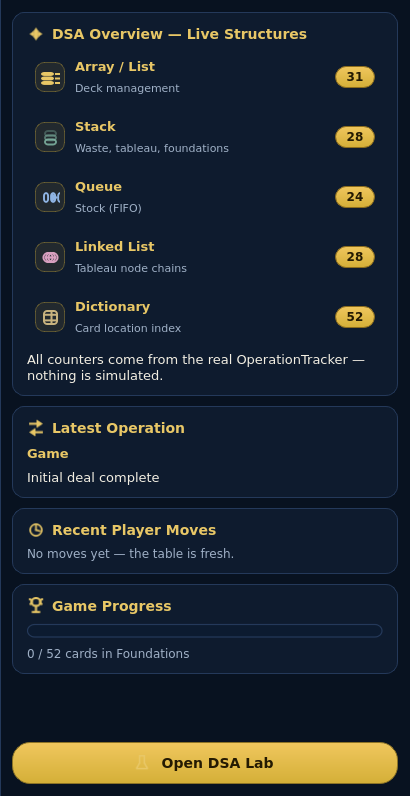</a>
</td>
<td width="50%" valign="top">
<strong>23 · DSA Lab Overview Detail</strong><br>
<sub>The dedicated DSA Lab workspace and its navigation.</sub><br><br>
<a href="docs/screenshots/pr_12_dsa_lab_overview.png">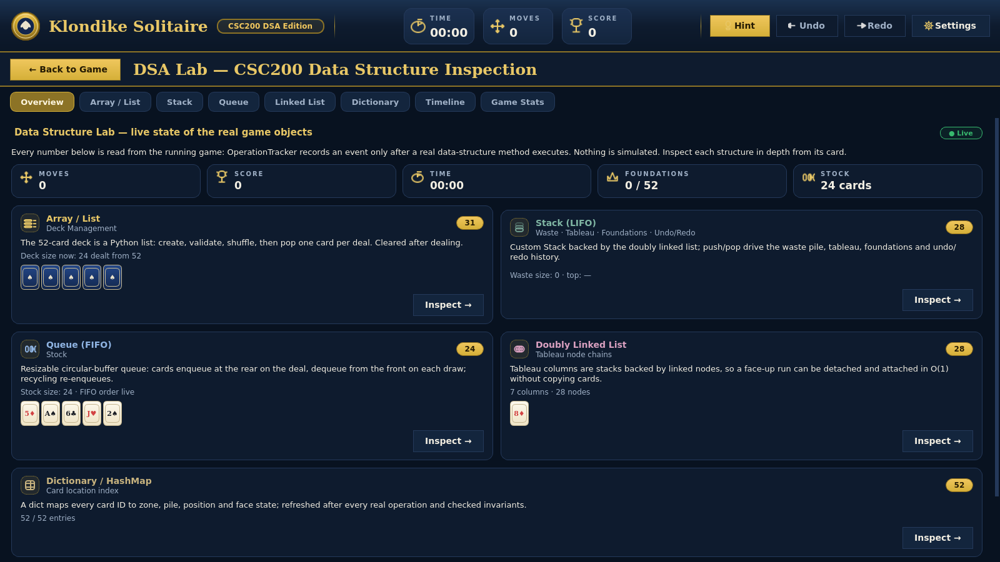</a>
</td>
</tr>
<tr>
<td width="50%" valign="top">
<strong>24 · Stack Inspector Detail</strong><br>
<sub>The Stack inspector showing its current pile data.</sub><br><br>
<a href="docs/screenshots/pr_12b_dsa_lab_stack.png">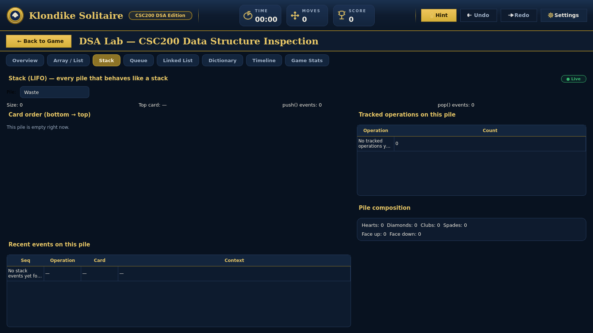</a>
</td>
<td width="50%" valign="top"></td>
</tr>
</table>

### Responsive Play and DSA Lab layouts

The following captures show the application at different viewport sizes and window states. They are visual references, not a substitute for testing on every display or DPI configuration.

<table>
<tr>
<td width="50%" valign="top">
<strong>25 · Play Workspace at 1280 × 800</strong><br>
<sub>Compact Play workspace at the 1280 × 800 reference size.</sub><br><br>
<a href="docs/screenshots/ds_10_play_1280x800.png">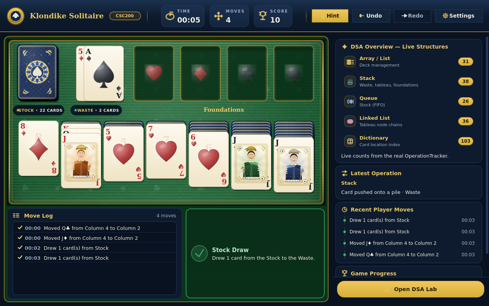</a>
</td>
<td width="50%" valign="top">
<strong>26 · Play Workspace at 1920 × 1029</strong><br>
<sub>Wide Play workspace on a larger display.</sub><br><br>
<a href="docs/screenshots/ds_11_play_1920x1029.png">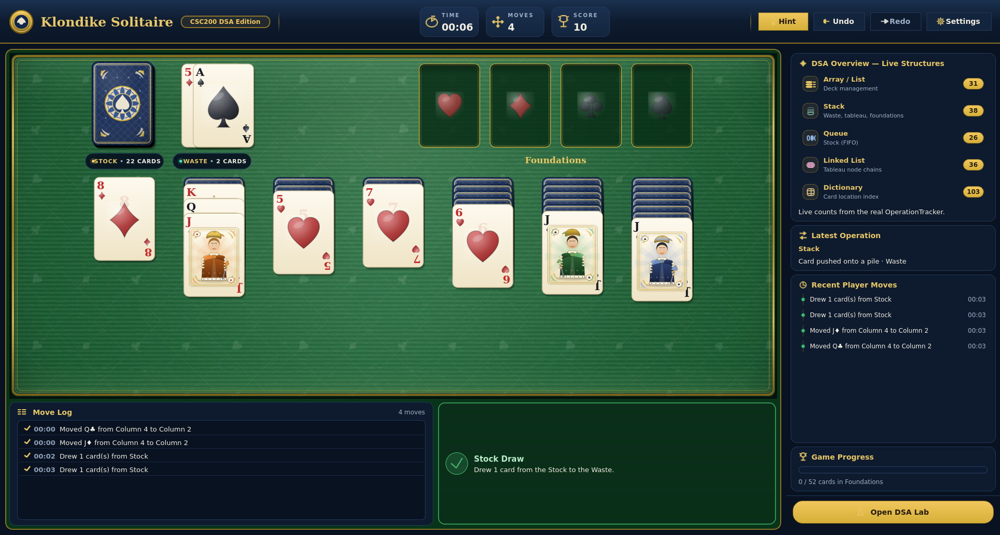</a>
</td>
</tr>
<tr>
<td width="50%" valign="top">
<strong>27 · DSA Lab at 1280 × 800</strong><br>
<sub>DSA Lab layout at the compact reference size.</sub><br><br>
<a href="docs/screenshots/ds_12_lab_1280x800.png">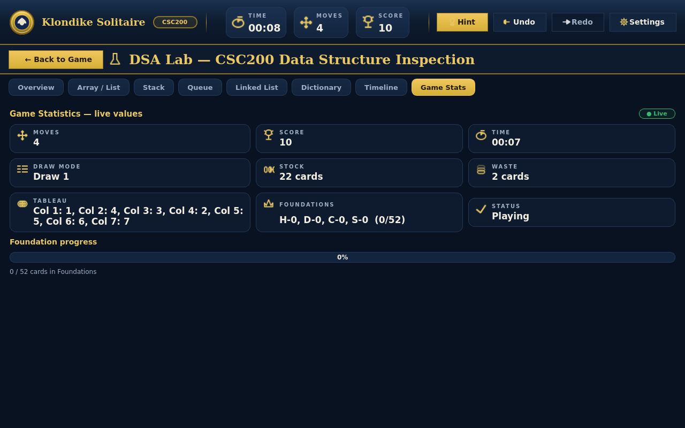</a>
</td>
<td width="50%" valign="top">
<strong>28 · Responsive Layout at 1280 × 800</strong><br>
<sub>Premium game layout at a compact desktop size.</sub><br><br>
<a href="docs/screenshots/pr_08_responsive_1280x800.png">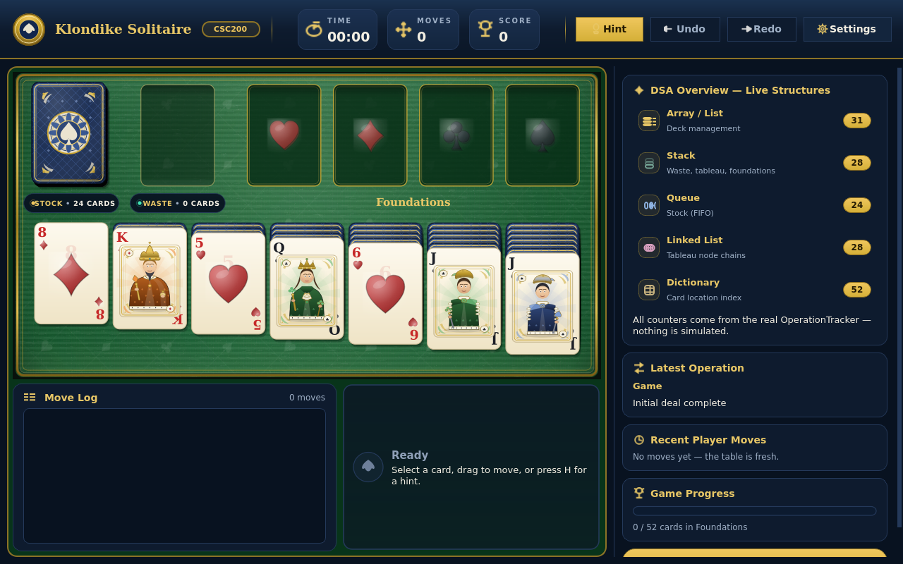</a>
</td>
</tr>
<tr>
<td width="50%" valign="top">
<strong>29 · Responsive Layout at 1920 × 1029</strong><br>
<sub>Premium game layout at a wide desktop size.</sub><br><br>
<a href="docs/screenshots/pr_09_responsive_1920x1029.png">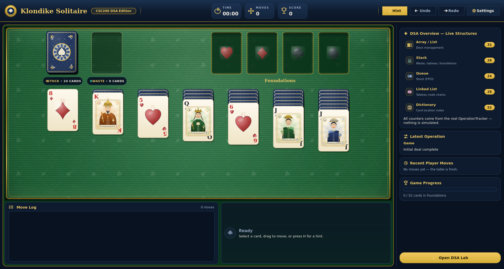</a>
</td>
<td width="50%" valign="top">
<strong>30 · Play Workspace at 1280 × 720</strong><br>
<sub>Short-height Play workspace reference.</sub><br><br>
<a href="docs/screenshots/ui_play_1280x720.png">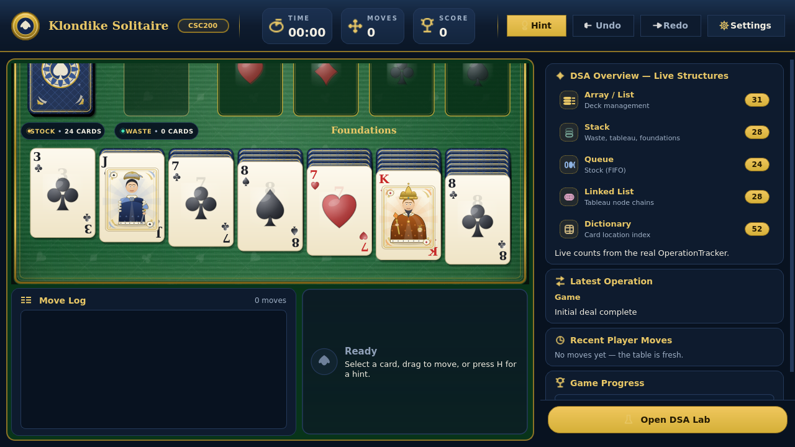</a>
</td>
</tr>
<tr>
<td width="50%" valign="top">
<strong>31 · Play Workspace at 1366 × 768</strong><br>
<sub>Play workspace at a common laptop resolution.</sub><br><br>
<a href="docs/screenshots/ui_play_1366x768.png">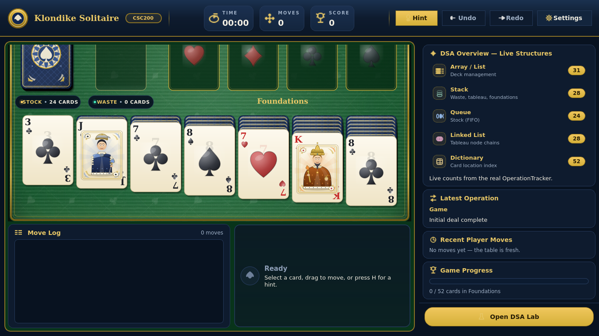</a>
</td>
<td width="50%" valign="top">
<strong>32 · Play Workspace at 1600 × 900</strong><br>
<sub>Play workspace at the design reference size.</sub><br><br>
<a href="docs/screenshots/ui_play_1600x900.png">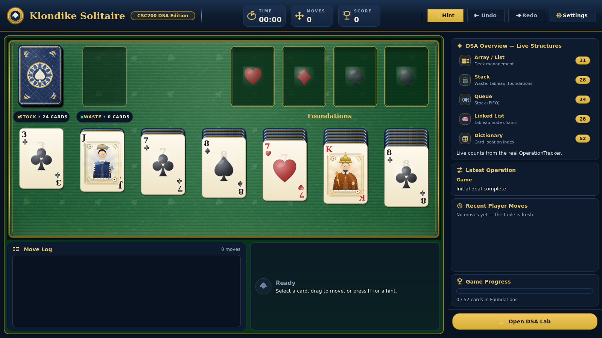</a>
</td>
</tr>
<tr>
<td width="50%" valign="top">
<strong>33 · Play Workspace at 1920 × 1080</strong><br>
<sub>Play workspace at Full HD resolution.</sub><br><br>
<a href="docs/screenshots/ui_play_1920x1080.png">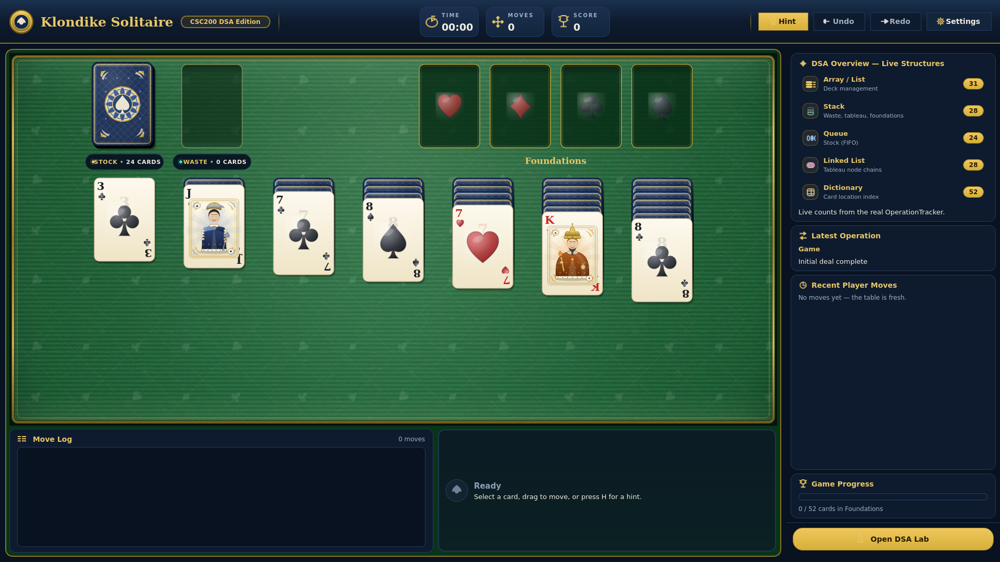</a>
</td>
<td width="50%" valign="top">
<strong>34 · Play Workspace After Window Transitions</strong><br>
<sub>Board after restore, resize, and maximize transitions.</sub><br><br>
<a href="docs/screenshots/ui_play_after_transitions.png">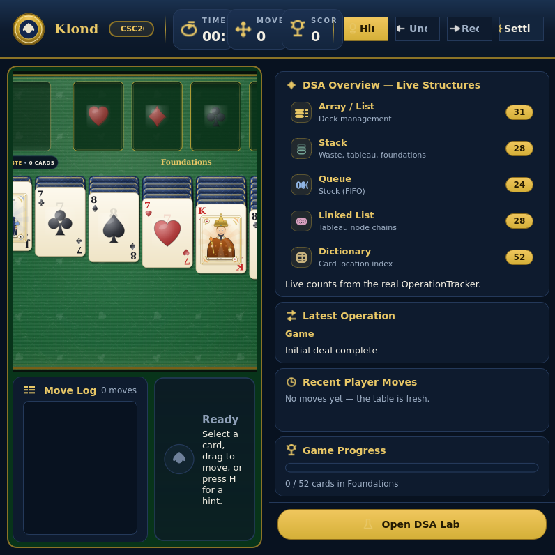</a>
</td>
</tr>
<tr>
<td width="50%" valign="top">
<strong>35 · Maximized Play Workspace</strong><br>
<sub>Play workspace in a maximized window.</sub><br><br>
<a href="docs/screenshots/ui_play_maximized.png">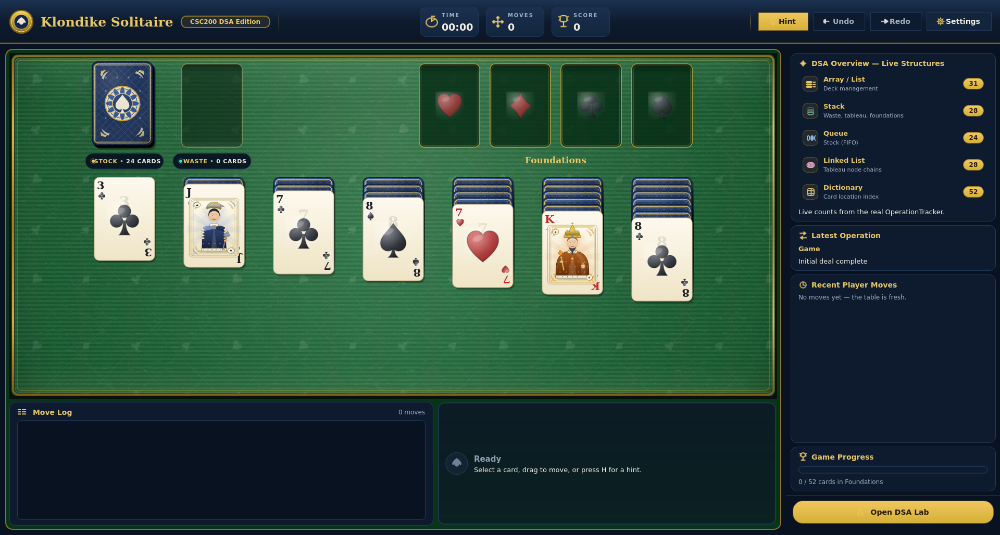</a>
</td>
<td width="50%" valign="top">
<strong>36 · Game Mode / Settings at 1280 × 720</strong><br>
<sub>Settings layout at a short-height reference size.</sub><br><br>
<a href="docs/screenshots/ui_settings_1280x720.png">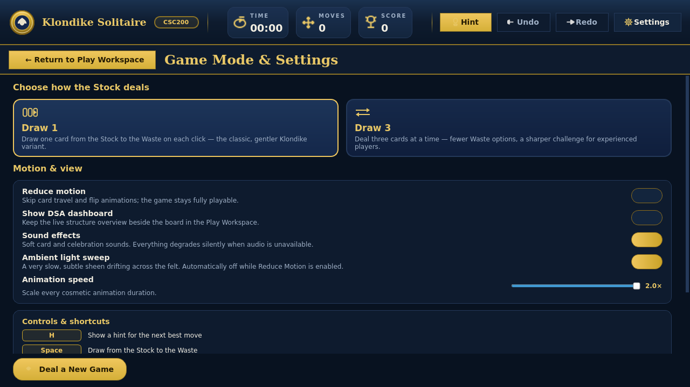</a>
</td>
</tr>
<tr>
<td width="50%" valign="top">
<strong>37 · Game Mode / Settings at 1600 × 900</strong><br>
<sub>Settings layout at the design reference size.</sub><br><br>
<a href="docs/screenshots/ui_settings_1600x900.png">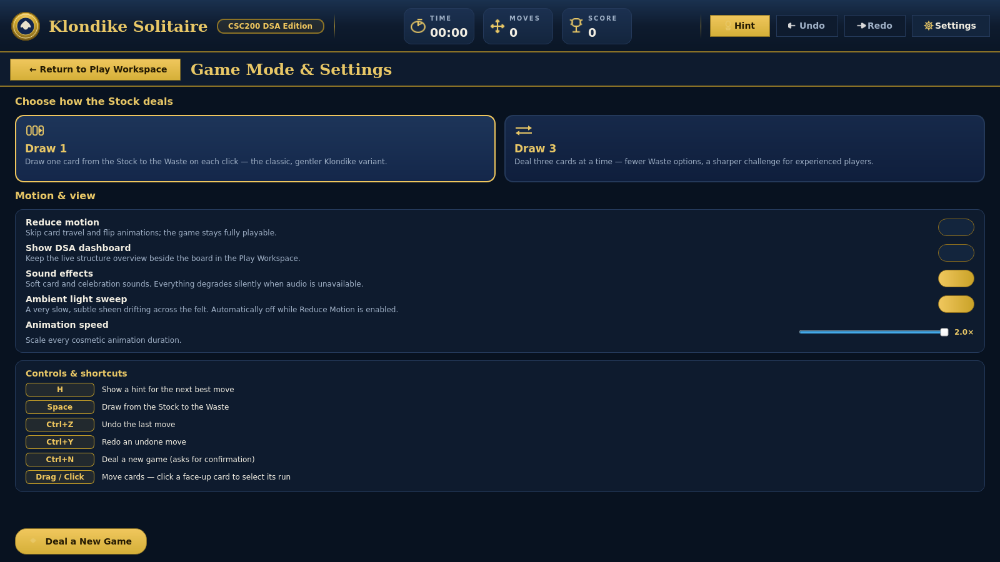</a>
</td>
<td width="50%" valign="top">
<strong>38 · Maximized Game Mode / Settings</strong><br>
<sub>Settings layout in a maximized window.</sub><br><br>
<a href="docs/screenshots/ui_settings_maximized.png">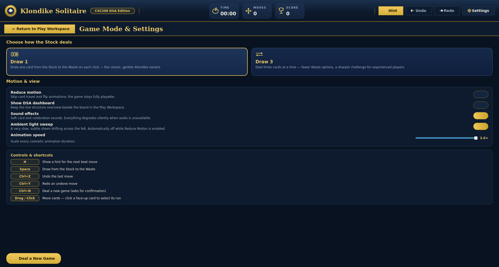</a>
</td>
</tr>
</table>


## What is implemented

### Solitaire gameplay

- Standard 52-card Klondike deck with unique card IDs, four suits, and thirteen ranks.
- Correct initial deal: seven Tableau columns containing 1–7 cards (28 cards total) and 24 cards in the Stock.
- **Draw 1** and **Draw 3** modes.
- Tableau moves follow descending rank and alternating red/black colors. Only a King-led sequence can be placed in an empty Tableau column.
- Foundations build from Ace to King, one suit per Foundation.
- Move cards from the Waste or Tableau to legal Tableau and Foundation destinations.
- Select and move a complete face-up Tableau run while preserving its order.
- The Stock can be recycled from the Waste when it is empty.
- Newly exposed face-down Tableau cards are automatically turned face-up.
- Invalid moves are rejected by the game rules without applying the requested pile change.
- Win detection checks that all four suit Foundations contain the complete, correctly ordered 52-card deck.

### Player features

- **Undo and Redo** backed by custom history Stacks.
- **Hint** finds a legal move from the current game state and visually highlights the suggested source and destination.
- **Timer** starts after the first successful player action and stops at victory.
- **Score** awards 10 points for a Foundation move, 5 points for a Waste-to-Tableau move, and 5 points for exposing a face-down Tableau card.
- **Move Log** records player-facing moves separately from the low-level DSA operation history.
- A feedback panel reports accepted actions and invalid moves.
- A non-blocking victory overlay shows the final score, move count, and elapsed time.

### Premium PyQt6 interface

- Emerald-felt game table with a multi-layer frame, lighting, and bundled card artwork.
- Custom card faces for the four suits and court cards, plus a designed card back.
- Click-to-select, click-to-move, and drag-and-drop interactions.
- Visible legal-destination highlighting, card selection effects, drag lift, and multi-card run dragging.
- Animated card dealing, stock draws, movement, flips, hints, invalid-move feedback, and Foundation effects.
- Optional card and victory sound effects using bundled audio files.
- Responsive Play workspace with a live DSA dashboard and a separate Move Log / feedback area.
- Persisted Game Mode settings for Draw 1 / Draw 3, dashboard visibility, Reduce Motion, sound effects, ambient light sweep, and animation speed (0.5×–2.0×).

### Live DSA dashboard and DSA Lab

The right-hand dashboard summarizes the five required data structures using counts from the real `OperationTracker`. It also shows the latest player-facing operation, recent moves, and Foundation progress. Selecting a structure opens its corresponding inspector.

The **Open DSA Lab** workspace provides eight pages:

| Page | What it shows |
|---|---|
| **Overview** | Live summary of the five data structures and current game activity. |
| **Array / List** | Deck creation, shuffle, deal, and remaining-stock lifecycle. |
| **Stack** | Stack state, card order, pile composition, and related operations. |
| **Queue** | Stock queue in FIFO order, including front/rear and queue activity. |
| **Linked List** | Tableau node chains, head/tail, links, and run detach/attach operations. |
| **Dictionary** | Searchable card index with each card's current zone, pile, position, and face state. |
| **Timeline** | Chronological low-level operations recorded during the current game. |
| **Game Stats** | Current game metrics and progress. |

The inspectors read the actual game model and operation tracker. Their counters and event history are not simulated demo data.

## How the five data structures are used

| Required structure | Implementation in this project |
|---|---|
| **Array / List** | A Python list represents the 52-card deck while it is created, validated, shuffled, and dealt. |
| **Stack** | A custom Stack ADT is used for pile operations, including Waste and Foundation piles. Tableau columns expose Stack behavior while using the linked-list nodes as their backing storage. Undo and Redo use two additional history Stacks. |
| **Queue** | A custom FIFO Queue backed by a resizable circular buffer manages the Stock. Cards are drawn from the front of the queue. |
| **Doubly Linked List** | Custom doubly linked nodes back the Tableau columns. A face-up run can be detached and attached while preserving node identity instead of copying card objects. |
| **Dictionary / Hash Map** | The `card_index` maps each stable card ID to its current zone, pile, position, and face-up/face-down state. |

The `OperationTracker` records events emitted by real data-structure and domain operations. The dashboard and DSA Lab use those events to present live structure counts and operation details.

## Technology

- **Language:** Python 3.12 or newer
- **Desktop UI:** PyQt6
- **Testing:** pytest
- **Architecture:** domain/game engine separated from the PyQt6 presentation layer
- **Assets:** bundled SVG card artwork, felt texture, and WAV sound effects

The game runs locally and does not require an external game API or online service.

## Getting started

### Requirements

- Python **3.12 or newer**
- Windows, Linux, or another desktop environment supported by PyQt6

### Windows PowerShell

Clone the repository and open PowerShell in the project directory:

```powershell
git clone https://github.com/luqmanbuttcs/dsa-project.git
cd dsa-project

py -3.12 -m venv .venv
.\.venv\Scripts\Activate.ps1

python -m pip install --upgrade pip
python -m pip install -e ".[dev]"
```

If PowerShell blocks virtual-environment activation, allow it for the current terminal session:

```powershell
Set-ExecutionPolicy -Scope Process -ExecutionPolicy Bypass
.\.venv\Scripts\Activate.ps1
```

### Launch the application

Start the premium interface:

```powershell
python -m solitaire.main
```

The earlier Phase 4 interface is retained as a fallback:

```powershell
python -m solitaire.main --legacy
```

## Controls

### Mouse

| Action | How to use it |
|---|---|
| Select a card | Click a face-up Tableau card or the top Waste card. |
| Move a selected card | Click a legal Tableau or Foundation destination. |
| Drag a card | Drag a Waste card or face-up Tableau card to a legal destination. |
| Move a Tableau run | Select or drag a face-up card in a Tableau column; the face-up sequence above it moves together. |
| Draw from Stock | Click the Stock pile. |
| Change draw mode | Open **Settings / Game Mode** and choose Draw 1 or Draw 3. |
| Inspect a data structure | Select its row in the dashboard or use **Open DSA Lab**. |

### Keyboard shortcuts

| Shortcut | Action |
|---|---|
| `H` | Show a legal-move hint |
| `Space` | Draw from the Stock |
| `Ctrl+Z` | Undo |
| `Ctrl+Y` | Redo |
| `Ctrl+N` | Deal a new game (asks before discarding a played game) |
| `Escape` | Dismiss the victory overlay when it is visible |

## Project structure

```text
dsa-project/
├── src/solitaire/
│   ├── domain/                 # Cards, deck, game state, rules, engine, operation tracker
│   ├── structures/             # Custom Stack, Queue, and doubly linked list
│   ├── ui/
│   │   ├── premium/             # Default PyQt6 application
│   │   │   ├── components/      # Header, dashboard, game panels, victory overlay
│   │   │   ├── controllers/     # Game, selection, drag, and navigation controllers
│   │   │   ├── dsa_lab/         # Eight live data-structure and stats inspectors
│   │   │   ├── graphics/        # Card and game-board rendering
│   │   │   ├── screens/         # Play, Game Mode, and DSA Lab workspaces
│   │   │   └── resources/       # Bundled artwork, texture, and audio
│   │   └── ...                  # Legacy Phase 4 interface and UI stability support
│   └── main.py                  # Application entry point
├── tests/
│   ├── unit/                    # Data structures, rules, engine, and bonus features
│   ├── integration/             # End-to-end game-flow and validation tests
│   └── ui/                      # PyQt6, interaction, animation, and responsive-layout tests
├── tools/
│   ├── interaction_sweep.py     # Exercises UI interactions and checks for escaped exceptions
│   └── generate_audio.py        # Generates bundled sound assets
├── docs/
│   └── screenshots/             # Play workspace and DSA Lab screenshots
├── pyproject.toml
└── README.md
```

## Running tests

Install the development dependencies first:

```powershell
python -m pip install -e ".[dev]"
```

Run the complete automated test suite:

```powershell
python -m pytest
```

Run the UI interaction sweep:

```powershell
python tools/interaction_sweep.py
```

The interaction sweep opens the Qt application offscreen and exercises representative interactions across the game, dashboard, settings, DSA Lab pages, and window lifecycle. A clean run ends with:

```text
SWEEP CLEAN — no exception escaped any slot
```

### Latest verified GitHub Actions run

The post-merge workflow on `main` commit `b63a9c7` completed successfully:

| CI job | Environment | Test suite | Interaction sweep |
|---|---|---:|---|
| Linux | Ubuntu, Python 3.12.16 | 229 passed | Clean |
| Windows | Windows, Python 3.14.7 | 229 passed | Clean |

[View GitHub Actions run #268](https://github.com/luqmanbuttcs/dsa-project/actions/runs/42897392606).

CI uses Qt's offscreen platform. It verifies the automated game, data-structure, UI, and interaction checks; it does not replace a final hands-on visual and mouse-feel check on the target computer.

## Notes

- A randomly shuffled Klondike deal is not guaranteed to be solvable.
- The default command launches the premium interface; use `--legacy` only when you specifically need the earlier Phase 4 window.
- The DSA Lab reflects the current game session. Starting a new game resets the game state and its operation trace.
