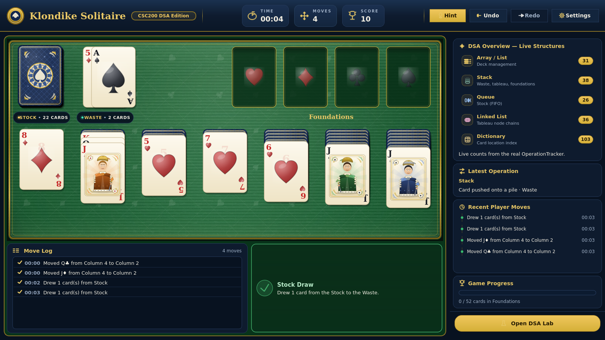
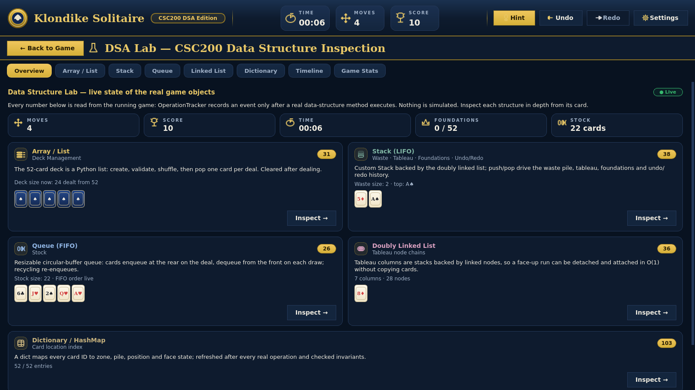

# Klondike Solitaire — CSC200 DSA Edition

[](https://github.com/luqmanbuttcs/dsa-project/actions/workflows/tests.yml)


A desktop **Klondike Solitaire** game built with Python and PyQt6 for the CSC200 Data Structures and Algorithms project. It combines a playable Solitaire implementation with a live **DSA Lab** that lets viewers inspect the data structures used by the running game.

The default application is the premium casino-style interface. The game rules and data model are kept separate from the presentation layer: the UI sends player actions to the game controller and engine, while the engine validates and applies the actual game-state changes.

## Screenshots

### Play workspace



### DSA Lab



The repository also contains individual screenshots of the Array/List, Stack, Queue, Linked List, Dictionary, Timeline, and Game Stats inspectors in [docs/screenshots](docs/screenshots/).

## What is implemented

### Solitaire gameplay

- Standard 52-card Klondike deck with unique card IDs, four suits, and thirteen ranks.
- Correct initial deal: seven Tableau columns containing 1–7 cards (28 cards total) and 24 cards in the Stock.
- **Draw 1** and **Draw 3** modes.
- Tableau moves follow descending rank and alternating red/black colors. Only a King-led sequence can be placed in an empty Tableau column.
- Foundations build from Ace to King, one suit per Foundation.
- Move cards from the Waste or Tableau to legal Tableau and Foundation destinations.
- Select and move a complete face-up Tableau run while preserving its order.
- The Stock can be recycled from the Waste when it is empty.
- Newly exposed face-down Tableau cards are automatically turned face-up.
- Invalid moves are rejected by the game rules without applying the requested pile change.
- Win detection checks that all four suit Foundations contain the complete, correctly ordered 52-card deck.

### Player features

- **Undo and Redo** backed by custom history Stacks.
- **Hint** finds a legal move from the current game state and visually highlights the suggested source and destination.
- **Timer** starts after the first successful player action and stops at victory.
- **Score** awards 10 points for a Foundation move, 5 points for a Waste-to-Tableau move, and 5 points for exposing a face-down Tableau card.
- **Move Log** records player-facing moves separately from the low-level DSA operation history.
- A feedback panel reports accepted actions and invalid moves.
- A non-blocking victory overlay shows the final score, move count, and elapsed time.

### Premium PyQt6 interface

- Emerald-felt game table with a multi-layer frame, lighting, and bundled card artwork.
- Custom card faces for the four suits and court cards, plus a designed card back.
- Click-to-select, click-to-move, and drag-and-drop interactions.
- Visible legal-destination highlighting, card selection effects, drag lift, and multi-card run dragging.
- Animated card dealing, stock draws, movement, flips, hints, invalid-move feedback, and Foundation effects.
- Optional card and victory sound effects using bundled audio files.
- Responsive Play workspace with a live DSA dashboard and a separate Move Log / feedback area.
- Persisted Game Mode settings for Draw 1 / Draw 3, dashboard visibility, Reduce Motion, sound effects, ambient light sweep, and animation speed (0.5×–2.0×).

### Live DSA dashboard and DSA Lab

The right-hand dashboard summarizes the five required data structures using counts from the real `OperationTracker`. It also shows the latest player-facing operation, recent moves, and Foundation progress. Selecting a structure opens its corresponding inspector.

The **Open DSA Lab** workspace provides eight pages:

| Page | What it shows |
|---|---|
| **Overview** | Live summary of the five data structures and current game activity. |
| **Array / List** | Deck creation, shuffle, deal, and remaining-stock lifecycle. |
| **Stack** | Stack state, card order, pile composition, and related operations. |
| **Queue** | Stock queue in FIFO order, including front/rear and queue activity. |
| **Linked List** | Tableau node chains, head/tail, links, and run detach/attach operations. |
| **Dictionary** | Searchable card index with each card's current zone, pile, position, and face state. |
| **Timeline** | Chronological low-level operations recorded during the current game. |
| **Game Stats** | Current game metrics and progress. |

The inspectors read the actual game model and operation tracker. Their counters and event history are not simulated demo data.

## How the five data structures are used

| Required structure | Implementation in this project |
|---|---|
| **Array / List** | A Python list represents the 52-card deck while it is created, validated, shuffled, and dealt. |
| **Stack** | A custom Stack ADT is used for pile operations, including Waste and Foundation piles. Tableau columns expose Stack behavior while using the linked-list nodes as their backing storage. Undo and Redo use two additional history Stacks. |
| **Queue** | A custom FIFO Queue backed by a resizable circular buffer manages the Stock. Cards are drawn from the front of the queue. |
| **Doubly Linked List** | Custom doubly linked nodes back the Tableau columns. A face-up run can be detached and attached while preserving node identity instead of copying card objects. |
| **Dictionary / Hash Map** | The `card_index` maps each stable card ID to its current zone, pile, position, and face-up/face-down state. |

The `OperationTracker` records events emitted by real data-structure and domain operations. The dashboard and DSA Lab use those events to present live structure counts and operation details.

## Technology

- **Language:** Python 3.12 or newer
- **Desktop UI:** PyQt6
- **Testing:** pytest
- **Architecture:** domain/game engine separated from the PyQt6 presentation layer
- **Assets:** bundled SVG card artwork, felt texture, and WAV sound effects

The game runs locally and does not require an external game API or online service.

## Getting started

### Requirements

- Python **3.12 or newer**
- Windows, Linux, or another desktop environment supported by PyQt6

### Windows PowerShell

Clone the repository and open PowerShell in the project directory:

```powershell
git clone https://github.com/luqmanbuttcs/dsa-project.git
cd dsa-project

py -3.12 -m venv .venv
.\.venv\Scripts\Activate.ps1

python -m pip install --upgrade pip
python -m pip install -e ".[dev]"
```

If PowerShell blocks virtual-environment activation, allow it for the current terminal session:

```powershell
Set-ExecutionPolicy -Scope Process -ExecutionPolicy Bypass
.\.venv\Scripts\Activate.ps1
```

### Launch the application

Start the premium interface:

```powershell
python -m solitaire.main
```

The earlier Phase 4 interface is retained as a fallback:

```powershell
python -m solitaire.main --legacy
```

## Controls

### Mouse

| Action | How to use it |
|---|---|
| Select a card | Click a face-up Tableau card or the top Waste card. |
| Move a selected card | Click a legal Tableau or Foundation destination. |
| Drag a card | Drag a Waste card or face-up Tableau card to a legal destination. |
| Move a Tableau run | Select or drag a face-up card in a Tableau column; the face-up sequence above it moves together. |
| Draw from Stock | Click the Stock pile. |
| Change draw mode | Open **Settings / Game Mode** and choose Draw 1 or Draw 3. |
| Inspect a data structure | Select its row in the dashboard or use **Open DSA Lab**. |

### Keyboard shortcuts

| Shortcut | Action |
|---|---|
| `H` | Show a legal-move hint |
| `Space` | Draw from the Stock |
| `Ctrl+Z` | Undo |
| `Ctrl+Y` | Redo |
| `Ctrl+N` | Deal a new game (asks before discarding a played game) |
| `Escape` | Dismiss the victory overlay when it is visible |

## Project structure

```text
dsa-project/
├── src/solitaire/
│   ├── domain/                 # Cards, deck, game state, rules, engine, operation tracker
│   ├── structures/             # Custom Stack, Queue, and doubly linked list
│   ├── ui/
│   │   ├── premium/             # Default PyQt6 application
│   │   │   ├── components/      # Header, dashboard, game panels, victory overlay
│   │   │   ├── controllers/     # Game, selection, drag, and navigation controllers
│   │   │   ├── dsa_lab/         # Eight live data-structure and stats inspectors
│   │   │   ├── graphics/        # Card and game-board rendering
│   │   │   ├── screens/         # Play, Game Mode, and DSA Lab workspaces
│   │   │   └── resources/       # Bundled artwork, texture, and audio
│   │   └── ...                  # Legacy Phase 4 interface and UI stability support
│   └── main.py                  # Application entry point
├── tests/
│   ├── unit/                    # Data structures, rules, engine, and bonus features
│   ├── integration/             # End-to-end game-flow and validation tests
│   └── ui/                      # PyQt6, interaction, animation, and responsive-layout tests
├── tools/
│   ├── interaction_sweep.py     # Exercises UI interactions and checks for escaped exceptions
│   └── generate_audio.py        # Generates bundled sound assets
├── docs/
│   └── screenshots/             # Play workspace and DSA Lab screenshots
├── pyproject.toml
└── README.md
```

## Running tests

Install the development dependencies first:

```powershell
python -m pip install -e ".[dev]"
```

Run the complete automated test suite:

```powershell
python -m pytest
```

Run the UI interaction sweep:

```powershell
python tools/interaction_sweep.py
```

The interaction sweep opens the Qt application offscreen and exercises representative interactions across the game, dashboard, settings, DSA Lab pages, and window lifecycle. A clean run ends with:

```text
SWEEP CLEAN — no exception escaped any slot
```

### Latest verified GitHub Actions run

The post-merge workflow on `main` commit `b63a9c7` completed successfully:

| CI job | Environment | Test suite | Interaction sweep |
|---|---|---:|---|
| Linux | Ubuntu, Python 3.12.16 | 229 passed | Clean |
| Windows | Windows, Python 3.14.7 | 229 passed | Clean |

[View GitHub Actions run #268](https://github.com/luqmanbuttcs/dsa-project/actions/runs/42897392606).

CI uses Qt's offscreen platform. It verifies the automated game, data-structure, UI, and interaction checks; it does not replace a final hands-on visual and mouse-feel check on the target computer.

## Notes

- A randomly shuffled Klondike deal is not guaranteed to be solvable.
- The default command launches the premium interface; use `--legacy` only when you specifically need the earlier Phase 4 window.
- The DSA Lab reflects the current game session. Starting a new game resets the game state and its operation trace.
